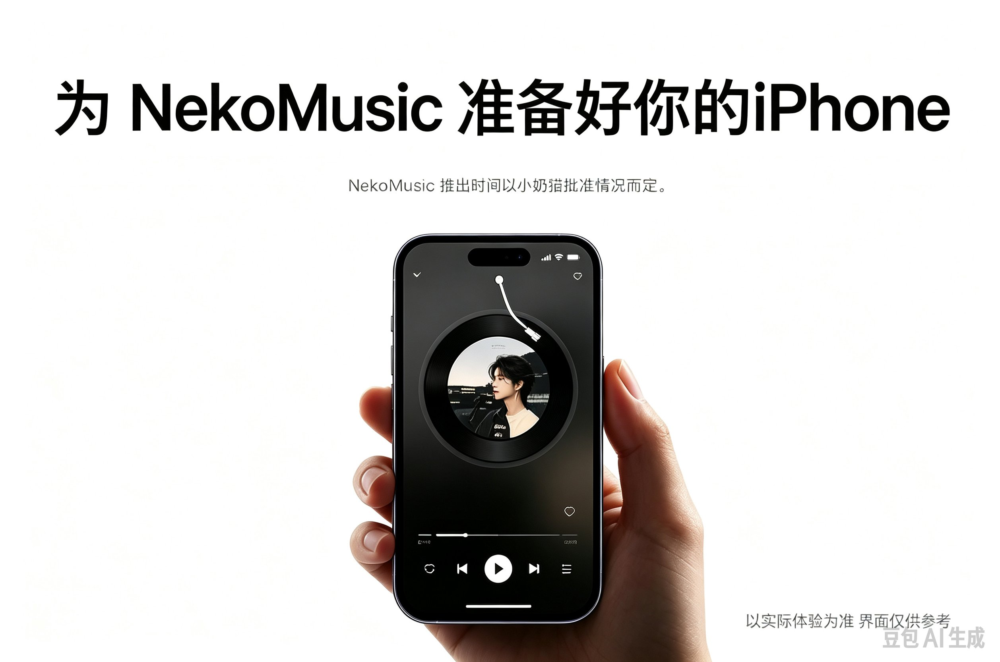
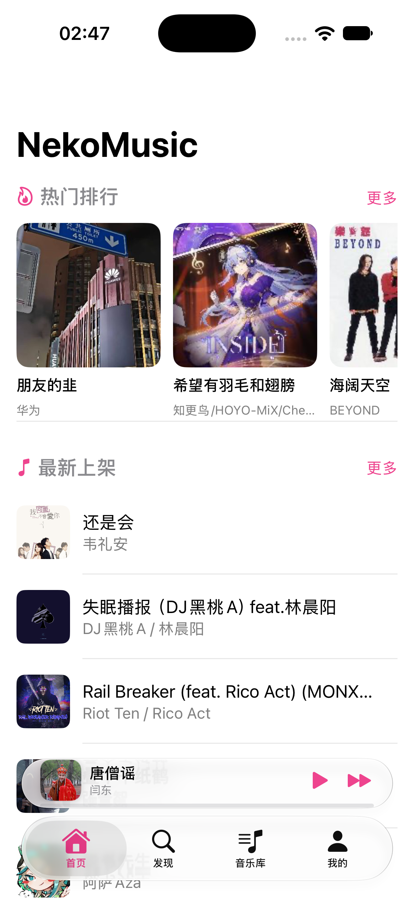
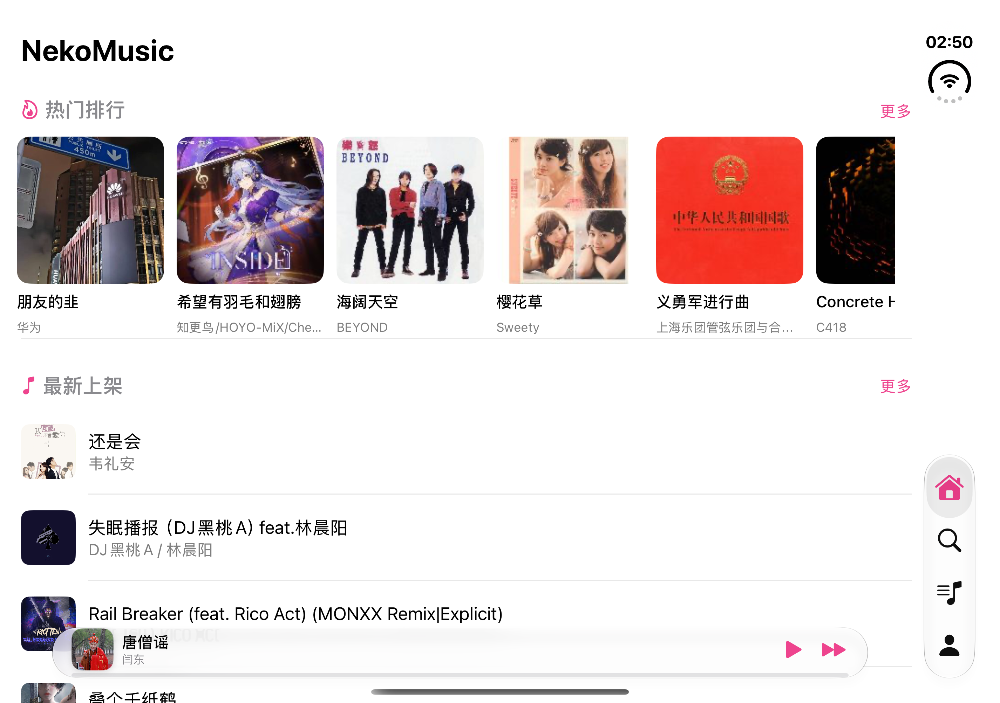

# NekoMusic iOS



> 为 NekoMusic 准备好你的 iPhone。

NekoMusic 的 iOS 原生客户端，使用 SwiftUI 重写，对接自建的 NekoMusic 曲库服务。
不带任何音源，曲库、账号、歌单全部由你自己的后端提供。

---

## 项目介绍

NekoMusic iOS 是一个轻量、原生、无广告的音乐播放器客户端。界面遵循 iOS 原生交互，
支持后台播放与锁屏控制，并针对中文音乐场景做了歌单导入的适配。

**主要功能**

- 首页热门排行、最新上架，支持下拉刷新与「更多」列表页
- 全库搜索（歌曲 / 歌手），搜索即播
- 推荐歌单、歌单详情、一键播放全部
- 账号体系：注册、邮箱验证码、登录、修改密码、密码重置接口
- 我的收藏、我的歌单，支持创建与删除歌单
- 网易云音乐 / QQ 音乐歌单导入：粘贴分享链接或歌单 ID，自动在曲库中批量匹配并生成同名歌单
- 三种播放模式：列表循环、单曲循环、随机播放
- 锁屏 / 控制中心封面、标题、进度与远程控制，支持耳机线控
- LRC 歌词解析与逐行高亮

**技术栈**

| 项 | 说明 |
|---|---|
| UI | SwiftUI（纯原生，无 WebView、无第三方 UI 库） |
| 音频 | AVFoundation（`AVPlayer`）+ MediaPlayer（锁屏信息与远程控制） |
| 网络 | `URLSession` + `Codable` / `JSONSerialization` |
| 最低版本 | iOS 16.0 |
| 依赖 | 无（不依赖 CocoaPods / SPM） |
| 构建 | Xcode 15+，fastlane 可选 |
| 当前版本 | 2.0.0（[更新日志](CHANGELOG.md)） |

## 为 iPhone Duo 与液态玻璃而生

**我们适配了 iOS 最新的液态玻璃效果，不仅如此，我们还适配了 iPhone dou！！**

- 使用 iOS 26 / 27 SDK 构建，系统 Tab 栏、导航栏与工具栏自动采用 **Liquid Glass** 材质，
  跟随系统版本自动获得新外观
- **折叠与展开无缝自适应**：合上时按外屏尺寸重排，展开后充分利用内屏的横向空间
- 展开后工具栏自动**竖排到右侧**，与 iPhone Duo 的系统布局一致
- 播放页在宽屏形态下额外提供右侧返回入口，同时保留左边缘侧滑返回
- 布局基于可用空间与 size class 计算，不依赖固定屏幕尺寸，也不依赖设备方向

## 界面预览

**iPhone 18 Pro**



**iPhone Duo（展开）**



---

## 如何安装

iOS 应用**必须签名**才能安装到设备上，NekoMusic 没有上架 App Store，也没有 TestFlight 分发，
所以只能通过**自己编译签名**的方式装到自己的 iPhone 上。

> 服务端地址已经内置在 App 中，装完即可直接注册、搜索和播放，**不需要配置任何参数**。
> 只有想换成自己的服务端时才需要改代码，见下方「可选：自建后端」。

**准备工作**

1. 一台 macOS，安装 Xcode 15 或更高版本（App Store 下载）
2. 一个 Apple ID，在 Xcode 中登录（Xcode → Settings → Accounts）
   - 免费 Apple ID 即可，无需付费开发者账号
3. 一台 iOS 16.0 及以上的 iPhone，以及一根数据线

### 方式一：Xcode 直接运行（推荐）

```bash
git clone https://github.com/wlt743/NekoMusicForIOS_Not-web.git
cd NekoMusicForIOS_Not-web
open NekoMusic.xcodeproj
```

1. 在 Xcode 左侧选中项目 `NekoMusic` → TARGETS `NekoMusic` → **Signing & Capabilities**
2. 勾选 **Automatically manage signing**，在 **Team** 中选择你自己的 Apple ID
3. 把 **Bundle Identifier** 改成全世界唯一的标识，例如 `com.你的名字.nekomusic`
4. 用数据线连接 iPhone，在 Xcode 顶部设备列表中选择你的手机
5. 首次运行需要在手机上开启开发者模式：
   **设置 → 隐私与安全性 → 开发者模式 → 打开**，然后重启手机
6. 点击 ▶️ Run，等待编译安装完成
7. 如果提示「不受信任的开发者」，到
   **设置 → 通用 → VPN 与设备管理 → 开发者 App** 中信任你的 Apple ID

> 免费 Apple ID 签名的应用 **7 天后过期**，到期需要重新用 Xcode 运行一次；
> 免费账号同时最多注册 3 台设备。付费开发者账号（$99/年）签名为 1 年有效期。

### 方式二：fastlane 打包签名 IPA

适合需要分发给多台设备，或想保留一个可反复安装的安装包。

```bash
cd NekoMusicForIOS_Not-web
bundle install          # 安装 fastlane
fastlane pack           # 产出 build/NekoMusic.ipa
```

打包前需要把签名信息改成你自己的：

- `fastlane/Appfile`：`app_identifier` 与 `team_id`
- `ExportOptions.plist`：`teamID`，以及按需把 `method` 改为
  `development`（真机调试）/ `ad-hoc`（指定设备分发）

产出的 `build/NekoMusic.ipa` 可以用 Xcode（Window → Devices and Simulators）、
Apple Configurator 或爱思助手等工具安装到已登记的设备上。
同样需要签名，**未签名的 IPA 无法安装**。

### 常见问题

- **编译报错 `No such module` / 找不到 SDK**：确认 Xcode 已安装 iOS 平台组件
  （Xcode → Settings → Components），或升级到最新版 Xcode
- **无法选择真机**：检查数据线、信任这台电脑，并确认已在手机上开启开发者模式
- **应用闪退**：先在 Xcode 控制台查看错误日志，确认网络与服务端接口正常
- **歌曲能搜到但播放失败**：确认后端 `/api/music/file/{id}` 可访问，且返回的是音频流

---

## 可选：自建后端

App 默认已经指向 `https://music.cnmsb.xin`，编译安装后即可直接使用，**不需要任何配置**。

只有在以下情况下才需要修改：

- 想使用自己的 NekoMusic 服务端
- 官方地址变更或服务下线
- 二次开发、接口对接

修改位置只有一个，`NekoMusic/Services/APIConfig.swift`：

```swift
static let baseURL = "https://music.cnmsb.xin"
```

把它换成自己的服务地址后重新编译即可。所有接口都由这个常量拼接，没有其他配置项，
也没有设置页或环境变量需要填。

`Info.plist` 已开启 `NSAllowsArbitraryLoads`，方便开发阶段使用 HTTP 服务；
正式环境建议改用 HTTPS 并关闭该选项。

---

## 免责声明

本项目仅用于学习与个人自建服务的技术交流，不提供、不存储、不分发任何音乐资源。
曲库内容、账号数据均由使用者自行搭建的服务提供，音乐版权归各版权方所有。
请勿将本项目用于任何商业用途。

## 许可证

[GNU Affero General Public License v3.0](LICENSE)
